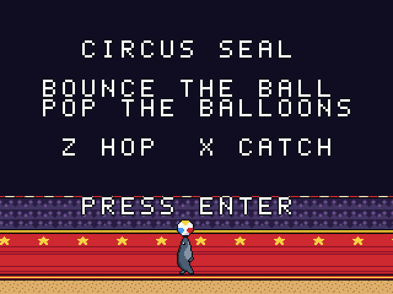
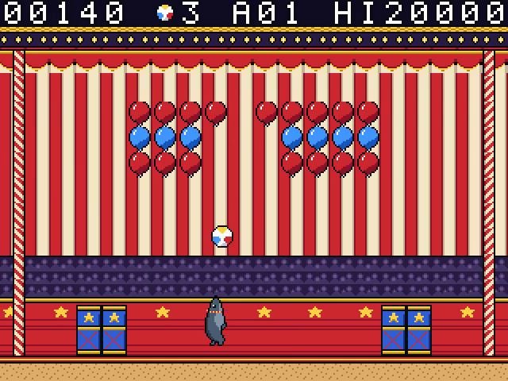
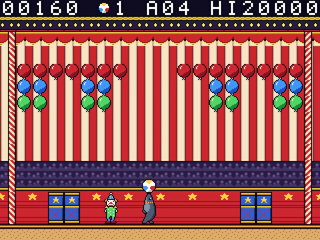

# Circus Seal

Keep a beach ball in the air and pop every balloon under the big top. A single-screen mix of breakout and platforming, starring a show seal and twelve circus acts.

For the Zeal 8-bit computer with the Video Board, running Zeal 8-bit OS.

**Title Screen**



**Act 1**



**Act 4**



## Controls

Menu prompts default to a connected SNES pad and follow the last device used
in the menu. The selected keyboard/pad display stays fixed during the game.

| Action                          | Keyboard     | SNES pad |
| ------------------------------- | ------------ | -------- |
| Waddle                          | Left / Right | D-pad    |
| Hop (and serve)                 | Z or Space   | B        |
| Catch and balance (hold), serve | X            | A or Y   |
| Pause                           | Enter        | Start    |
| Quit to title                   | Right Shift  | Select   |

Enter starts the game on the title screen.

## How to play

- Bounce the ball off your nose and keep it in play.
- Pop all the balloons to clear an act.
- Use the platforms and handle each act’s obstacles to reach the next show.

## Build

Install the Zeal Development Environment (ZDE) and its SDK dependencies, then run
these commands from this repository:

```sh
zde deps install zgdk
zde deps install zar
zde cmake
```

The build produces `bin/circusseal.bin` and `bin/circusseal.zar`.
Use a current ZGDK installation.

## Run

For Zeal-NativeEmulator, mount the output folder as HostFS:

```sh
zeal-native -r /path/to/os_with_romdisk.img -H bin
```

At the ZOS prompt:

```text
cd H:/
exec circusseal.bin
```

On hardware, copy the `.bin` and `.zar` together and run the game from that folder.

Build variants, asset editing and optional development tools are documented in
[the development guide](docs/development.md).

## License

Copyright 2026 David Higgins. Game code and original assets are licensed under
[Apache License 2.0](LICENSE). External SDKs and tools retain their own licenses.
